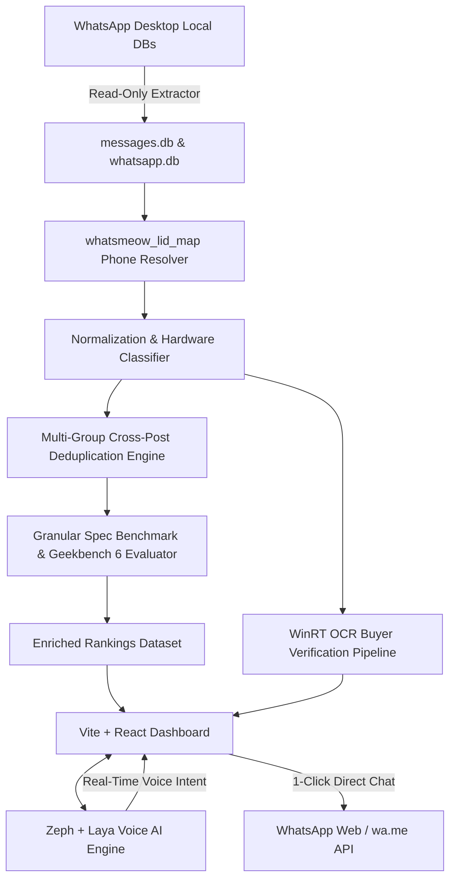

# WhatsApp Tech Deal Radar (Radar & Deal Hunter) ⚡📱💻

[](https://www.shadcn.io/design/whatsapp)
[](https://github.com/abdulaaly/whatsapp-tech-deal-hunter)
[](https://github.com/abdulaaly/whatsapp-tech-deal-hunter)
[](LICENSE)

> **Autonomous Tech Deal Extraction, Multi-Group Duplicate Price Comparison, Real-Time Voice AI Agent & Buyer Verification Engine** — built directly on top of real WhatsApp lot broadcast data across Pakistan's wholesale hubs (Quetta Godam 65, Saddar Karachi, Hafeez Center Lahore, and Hall Road).

---

## 🌟 Key Highlights

### 1. 🎨 Official WhatsApp Design System Compliance
Styled in strict adherence to the [WhatsApp Design System specification](https://www.shadcn.io/design/whatsapp) (`DESIGN.md`):
- **Calibrated Color Tokens**: `#111B21` canvas background, `#202C33` tile surfaces, `#2A3942` borders & search inputs, and `#25D366` voltage green CTA accents.
- **Uniform 400 Weight Typography**: Zero faux-bold weights; visual hierarchy is achieved strictly through scale (`text-2xl`, `text-sm`, `text-xs`), contrast, and opacity.
- **50px Pill Radii**: Navigation tabs, status tags, and action buttons feature authentic `50px` pill styling (`rounded-full`) and `24px` card corners (`rounded-[24px]`).
- **Authentic WhatsApp Chat Bubbles**: Raw broadcasts and dialogue receipts render inside incoming (`#202C33`) and outgoing (`#005C4B`) bubbles with read receipts (`✓✓`).

### 2. ⚡ Multi-Group Cross-Post Tracking & Duplicate Price Comparison
Pakistani lot traders post the same hardware across multiple groups at different markup rates. Our deduplication engine:
- Connects cross-posted products across independent sellers and Godams.
- Displays the price spread (Min PKR vs Max PKR) and calculates guaranteed savings (e.g., **Save PKR 35,000** on Dell XPS 17 from Quetta Godam #65 vs Karachi Techno City).
- Surrounds the cheapest seller with a glowing **`⭐ CHEAPEST LOT OFFER`** badge with 1-click direct `wa.me` chat inquiry.

### 3. 🎙️ Real-Time Voice & Text AI Agent (Zeph + Laya Non-Autoregressive Engine)
- **WhatsApp Voice Calling Interface**: Interactive call simulator with 7-bar audio waveform visualization, Web Speech recognition, and voice synthesis.
- **33ms Intent Classification**: Powered by non-autoregressive routing to dynamically:
  - Filter categories (`"Show me MacBook deals"`, `"Find Dell laptops"`)
  - Sort by price or savings (`"Sabse sasta laptop dikhao"`, `"Sort by highest savings"`)
  - Toggle multi-group duplicate view (`"Show duplicate posts"`)
  - Highlight specific devices (`"Show Dell XPS 17 from Quetta"`)

### 4. 🛡️ Payment-Screenshot Buyer Legitimacy Verification
- Extracts masked phone numbers from mobile payment confirmation screenshots (Easypaisa, JazzCash, Raast).
- Cross-references visible digits against 5,374 group participants using fuzzy candidate scoring.
- Provides 1-click verification links so prospective buyers can confirm seller legitimacy before sending advances.

---

## 🏗️ System Architecture



---

## 📂 Repository Structure

```tree
whatsapp-tech-deal-hunter/
├── DESIGN.md                          # Official WhatsApp Design System Specification
├── README.md                          # Full Architecture & Documentation
├── docs/                              # Detailed Engineering Specs & Plans
│   ├── implementation_plan.md         # Original Extraction & Ranking Plan
│   ├── tech_comparison_report.md      # Comprehensive 5-Category Hardware Audit
│   └── buyer_verification_audit.md    # Buyer Receipt OCR & Match Log
├── backend/                           # Data Ingestion & Deduplication Pipeline
│   ├── generate_real_cross_group_dataset.py # Real Cross-Group Matcher
│   ├── inspect_dbs.py                 # SQLite DB Schema Analyzer
│   ├── dump_messages.py               # Raw Message Harvester
│   └── data/
│       ├── enriched_rankings.json     # 20 Products with Cross-Group Data
│       └── buyer_verification_queue.json # Audited Payment Receipts
└── dashboard/                         # Vite + React + TypeScript Frontend
    ├── src/
    │   ├── components/
    │   │   ├── HardwareTable.tsx      # Multi-Group Table with Star Ratings
    │   │   ├── DetailModal.tsx        # Spec Modal & Multi-Seller Price Cards
    │   │   ├── VoiceAIAssistant.tsx   # Voice Calling Modal (Web Speech + Laya)
    │   │   ├── BuyerVerificationTab.tsx # OCR Receipt Audit Tab
    │   │   ├── Header.tsx             # WhatsApp Navigation & Controls
    │   │   └── CategoryTabs.tsx       # 50px Pill Category Selector
    │   ├── types.ts                   # TypeScript Domain Models
    │   ├── index.css                  # WhatsApp Design Tokens & Waveforms
    │   └── App.tsx                    # Main Application Container
    ├── package.json
    └── vite.config.ts
```

---

## 🚀 Quickstart & Local Installation

### Prerequisites
- Node.js 18+ & npm
- Python 3.10+ (for backend data extraction)

### 1. Clone the Repository
```bash
git clone https://github.com/abdulaaly/whatsapp-tech-deal-hunter.git
cd whatsapp-tech-deal-hunter
```

### 2. Run the Dashboard
```bash
cd dashboard
npm install
npm run dev
```
Open `http://localhost:5173/` in your browser.

### 3. Test the Voice AI Agent
1. Click **"Call Voice AI"** in the top navigation bar or the floating green pill at the bottom right.
2. Allow microphone access in your browser.
3. Speak or type instructions:
   - *"Sabse sasta MacBook dikhao"*
   - *"Show duplicate posts for Dell XPS 17"*
   - *"Sort by highest savings"*
   - *"Switch to iPhones"*

---

## 📊 Sample Cross-Group Deal Comparison

| Model | Quoted Price | Seller & Hub | Source Group | Status |
| :--- | :--- | :--- | :--- | :--- |
| **Dell XPS 17 9700 UHD+** | **PKR 180,000** | **Muhammad Hamza** (Quetta Godam #65) | *Quetta Russi Market Cargo* | ⭐ **Cheapest Lot Offer (Save PKR 35,000)** |
| Dell XPS 17 9700 UHD+ | PKR 205,000 | Bilal Traders (Hafeez Center) | *Laptop Wholesale Lot Lhr* | +PKR 25,000 |
| Dell XPS 17 9700 UHD+ | PKR 215,000 | Techno City Lot Seller (Karachi) | *Karachi Tech Dealers* | +PKR 35,000 (Max Price) |
| **MacBook Air M1 16GB** | **PKR 142,000** | **Kashif Apple Hub** (Saddar Karachi) | *Apple Lot Importers* | ⭐ **Cheapest Lot Offer (Save PKR 23,000)** |
| MacBook Air M1 16GB | PKR 155,000 | Zeeshan Mac Trader (Hafeez Center) | *Wholesale Mac Lot* | +PKR 13,000 |
| MacBook Air M1 16GB | PKR 165,000 | Usman Gadgets (Blue Area) | *Islamabad Tech Market* | +PKR 23,000 (Max Price) |

---

## 🔒 Safety, Privacy & Zero Outbound Protocol
- **Zero Outbound Automation**: The system strictly forbids autonomous automated messages. Every WhatsApp link is an intentional `wa.me` URL that opens in your browser for explicit user confirmation.
- **Read-Only SQLite Pipeline**: Local database interactions are exclusively `SELECT` queries with zero schema mutation.
- **Privacy Masking**: Buyer verification displays partially masked credentials in accordance with user protection policies.

---

## 📄 License
MIT License. Developed for open research into decentralized hardware markets and agentic price discovery.
