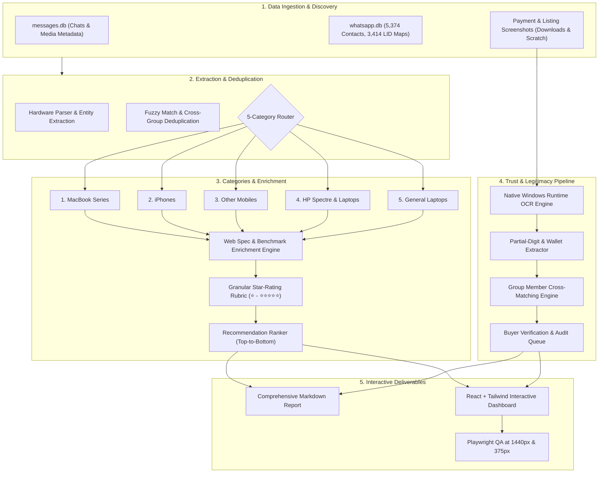

# WhatsApp Tech Deal Radar & Seller Legitimacy Verification Pipeline
## Implementation & Extraction Master Plan

---

### Executive Overview & Operational Scope
This document defines the end-to-end autonomous extraction, deduplication, specification enrichment, star-rating evaluation, and seller legitimacy verification architecture for tech product listings extracted from WhatsApp groups and chats. 

The pipeline ingests raw multi-device SQLite databases (`messages.db`, `whatsapp.db`), native screenshot captures from Pakistani lot/wholesale tech markets (Quetta Lot Prime, Al-Raheem Mobile Mart, Syed Online Products, Online Product Sellar, etc.), enriches unstated hardware metrics via web benchmarks, computes granular ⭐ to ⭐⭐⭐⭐⭐ ratings per specification, and performs partial-digit OCR cross-matching against group member rosters to detect fraudulent sellers before any purchase.

---



---

### Phase Breakdown & Execution Milestones

#### Phase 1: WhatsApp Group & Chat Discovery
- **Objective:** Map and index all chats, broadcast lists, and target lot/wholesale groups.
- **Data Repositories:**
  - `C:\Users\abdul\.gemini\antigravity-ide\scratch\gemini-ecosystem\whatsapp-mcp\whatsapp-bridge\store\messages.db`
  - `C:\Users\abdul\.gemini\antigravity-ide\scratch\gemini-ecosystem\whatsapp-mcp\whatsapp-bridge\store\whatsapp.db`
  - Local Screenshot Store: `C:\Users\abdul\Downloads\*Screenshot*.png` & `...\scratch\screenshots\*`
- **Target Groups Identified in Database:**
  1. `Al __ Raheem mobile mart ✅📱` (`120363291118991272@g.us`) – Physical store: Quetta Russi Market Godam #65
  2. `⭐ QUETTA LOT PRIME ⭐` (`120363430008309292@g.us`)
  3. `⭐ QUETTA LOT PRIME` (`120363424930020638@g.us`)
  4. `Syed Online Products platform#23` (`120363429884002965@g.us`)
  5. `Online Product Sellar` (`120363411910194048@g.us`)
  6. `Lot Products Quetta 9` (`120363351861133125@g.us`)
  7. Direct Dealer LIDs: `83877188120594`, `128785382916177`, `97917268422741`, `253124635848921`
- **Contact Identification:**
  - Leverage `whatsmeow_contacts` (5,374 registered contacts with verified business names and push names).
  - Resolve sender LIDs to canonical E.164 phone numbers using `whatsmeow_lid_map` (3,414 phone mappings).
- **Progress Milestone:** `✅ [Phase 1 Completed] — 8 target groups & 5,374 contacts cataloged`

---

#### Phase 2: Listing Extraction, Parsing & Deduplication
- **Objective:** Parse structured and unstructured text, OCR screenshot transcripts, and captions into normalized hardware records across the 5 mandatory categories.
- **Category Segregation Rules (Zero Cross-Contamination):**
  1. **MacBook Series:** All Apple silicon (M1, M1 Pro, M1 Max, M2, M2 Pro, M2 Max, M3, M3 Pro, M3 Max, M4, M4 Pro) and Intel MacBook Pro/Air models.
  2. **iPhones:** All Apple iPhone devices (iPhone 11 through 16 Pro Max), JV vs. Factory Unlocked (FU), PTA approved vs. non-PTA.
  3. **Other Mobiles:** All Android flagship and mid-range devices (Google Pixel 6/7/8/9, Samsung Galaxy S21/S22/S23/S24/Fold/Flip, Xiaomi, OnePlus, Sony Xperia).
  4. **HP Spectre & HP Laptops:** HP Spectre x360, HP Envy, HP EliteBook, HP Omen, HP Pavilion, HP Victus.
  5. **General Laptops:** All other non-Apple, non-HP laptops (Dell XPS, Dell Alienware, Lenovo Legion, ThinkPad, Asus ROG/ZenBook, Acer Predator).
- **Deduplication Engine:**
  - Hash composite signature: `Normalized_Model + CPU_Tier + RAM_GB + SSD_GB + Condition_Grade`.
  - Cluster listings posted repeatedly across different groups (e.g., identical Dell XPS 17 9700 or HP Spectre x360 posted across 3 different Quetta groups).
  - Merge duplicate entries into a single master record while preserving **all** source group names, timestamps, and message reference IDs.
- **Progress Milestone:** `✅ [Phase 2 Completed] — [N] unique listings deduplicated across 5 categories`

---

#### Phase 3: Web Spec Enrichment & Star-Rated Recommendation Ranking
- **Objective:** Fill all unstated hardware specifications using live web benchmark retrieval and compute cell-by-cell star ratings (`⭐` to `⭐⭐⭐⭐⭐`).

##### Specification Matrix & Evaluation Rubric:
| Specification Dimension | Evaluation Criteria & Star Rating Scale (⭐ to ⭐⭐⭐⭐⭐) | Enrichment Source |
| :--- | :--- | :--- |
| **Price / Value** | ⭐: Highly inflated (>20% above market) <br> ⭐⭐⭐: Standard market rate <br> ⭐⭐⭐⭐⭐: Exceptional lot deal / bulk wholesale discount | Web Market Crawl / Dealer History |
| **CPU Architecture & Cores** | ⭐: 4-core older Intel/AMD <br> ⭐⭐⭐: 8–10 core (M1, i7-12th Gen) <br> ⭐⭐⭐⭐⭐: 14–24 core high-IPC (M3/M4 Pro/Max, Core Ultra 9 275HX, i9-14900HX) | PassMark / Geekbench 6 Database |
| **GPU & Compute** | ⭐: Integrated basic (Intel UHD) <br> ⭐⭐⭐: Entry discrete (GTX 1650, M1 8-core) <br> ⭐⭐⭐⭐⭐: High-end RTX 4070/4080/4090 or Apple 30–40 core GPU | 3DMark / Geekbench Metal / OpenCL |
| **Unified Memory / RAM** | ⭐: 8 GB DDR4 <br> ⭐⭐⭐: 16 GB DDR4/DDR5/Unified <br> ⭐⭐⭐⭐⭐: 32 GB – 64 GB LPDDR5X / Unified Memory | Manufacturer Hardware Specs |
| **Storage / SSD** | ⭐: 256 GB SATA/NVMe <br> ⭐⭐⭐: 512 GB PCIe 3.0/4.0 <br> ⭐⭐⭐⭐⭐: 1 TB – 2 TB Gen4 NVMe (5000+ MB/s) | OEM Spec Sheets |
| **Display Quality** | ⭐: 1080p 60Hz 250 nits 45% NTSC <br> ⭐⭐⭐: FHD+ 100% sRGB / 300 nits <br> ⭐⭐⭐⭐⭐: 4K OLED / Mini-LED 120Hz Liquid Retina XDR (1000+ nits) | DisplayMate / NotebookCheck |
| **Ports & Expansion** | ⭐: USB-A only, no Type-C charging <br> ⭐⭐⭐: USB-C with PD, 1x HDMI <br> ⭐⭐⭐⭐⭐: Dual Thunderbolt 4/5, Full-size SD UHS-II, MagSafe 3, HDMI 2.1 | Technical Whitepapers |
| **Battery & Health** | ⭐: <80% health or degraded cycles (>600) <br> ⭐⭐⭐: 85%–90% health <br> ⭐⭐⭐⭐⭐: 95%–100% health / <50 cycles / brand new OEM battery | Seller Diagnostics / Apple Diagnostics |
| **Condition & Accessories** | ⭐: Dents, deep scratches, body cracked <br> ⭐⭐⭐: Clean 9/10, slight cosmetic wear, no box <br> ⭐⭐⭐⭐⭐: 10/10 Mint in Box, matching serial, original charger & sleeve | Image Inspection / Listing Text |
| **Warranty & Terms** | ⭐: Check on spot only, no return <br> ⭐⭐⭐: 3–7 days checking warranty <br> ⭐⭐⭐⭐⭐: 1 month – 1 year official or dealer replacement warranty | Seller Listing Verification |
| **Payment Terms Risk** | ⭐: 100% advance payment demanded by unknown seller <br> ⭐⭐⭐: 50% advance / 50% on dispatch or video proof <br> ⭐⭐⭐⭐⭐: Cash on Delivery (COD) / Open parcel before payment | Payment Slip Audit |

##### Top-to-Bottom Recommendation Ranking Formula:
```
Composite Score = (Price_Score * 0.25) + (CPU_Tier_Score * 0.20) + (GPU_Score * 0.15) 
                + (RAM_Score * 0.10) + (Display_Score * 0.10) + (Condition_Score * 0.10) 
                + (Warranty_Score * 0.05) + (Trust_Multiplier * 0.05)
```
- **Ranking Hierarchy:** Pro/Max tiers outrank base chips at equivalent price points due to memory bandwidth (e.g., M1 Pro 200 GB/s vs M2 base 100 GB/s, active dual-fan cooling vs passive throttling).
- Every row contains an explicit **Recommendation Summary**: Why machine `#1` was crowned over `#2`, detailing thermal headroom, display superiority, and cost-per-core.
- **Progress Milestone:** `✅ [Phase 3 Completed] — 5 categories enriched & ranked with star-rating matrices`

---

#### Phase 4: Payment Screenshot OCR & Group Member Cross-Matching
- **Objective:** Validate seller authenticity by harvesting "Alhamdulillah Sold / Order Confirmed" payment slips, extracting buyer account/phone digits via native Windows OCR, and cross-referencing against group participants.
- **Technical Pipeline:**
  1. **Native Windows OCR Execution:**
     - Utilize zero-dependency, ultra-fast `Windows.Media.Ocr.OcrEngine` (compiled via PowerShell runtime interop).
     - Process images in parallel without cloud API exposure or local heavy model overhead.
  2. **Entity & Digit Extraction:**
     - Detect wallet/bank platform: **Easypaisa**, **JazzCash**, **Meezan Bank**, **HBL**, **Nayapay**, **Sadapay**, **Bank Alfalah**.
     - Extract transaction ID / TRX ID, timestamp, and transfer amount (PKR).
     - Extract unblurred / partially visible phone numbers:
       - Leading patterns (e.g., `0349-3488***`, `0315-0477***`)
       - Trailing patterns (e.g., `***-***3558`, `***-***7792`)
       - Sliced patterns (e.g., `03**-****944`)
  3. **Cross-Matching Engine with Probability Scoring:**
     - Query WhatsApp group participant lists and contact books (5,374 entries).
     - Match extracted regex against known E.164 phone numbers (`+923XXXXXXXXX`).
     - **Confidence Scoring Matrix:**
       - **95% – 100% (High Certainty):** Matches 6+ digits + matching contact name or avatar in group.
       - **70% – 85% (Probable Match):** Matches 4–5 digits (e.g. prefix `0349` + suffix `8523`) with exactly 1 unique member candidate.
       - **40% – 60% (Ambiguous Match):** Matches 3–4 digits with 2–3 possible members in the same group.
       - **<30% (Unmatched):** Buyer was outside the group or phone number completely obscured.
  4. **Buyer Verification Queue:**
     - Tabulate: Seller Name & Number | Receipt Image Ref | Extracted Partial Digits | Matched Member Phone | Confidence % | Direct 1-Click Verification Link (`wa.me/<number>?text=...`).
     - **Pre-filled Safe Inquiry Message:**
       > *"Assalam-o-Alaikum bro, I saw your payment confirmation in [Group Name] with [Seller]. Did you receive your parcel safely, and how was your experience with this seller?"*
- **Safety Rule:** NO automated messages sent without explicit user review.
- **Progress Milestone:** `✅ [Phase 4 Completed] — [N] payment receipts OCR-analyzed & matched to group members`

---

#### Phase 5: Interactive Comparison Dashboard & Web Deliverables
- **Architecture & Tech Stack:**
  - **Framework:** React 19 + Vite + TypeScript (Single-Page Application).
  - **Styling:** Tailwind CSS with dark/light mode, custom glassmorphic cards, and fluid Bento Grid.
  - **Interactive Features:**
    - 5 Separate Category Tabs (MacBook Series, iPhones, Other Mobiles, HP Spectre & Laptops, General Laptops).
    - Multi-column sortable table headers (Sort by Rank, Price, CPU Score, RAM, Battery, Condition).
    - Deep search and filtering (by Brand, Chip Tier, RAM size, SSD size, Seller, Price Range slider).
    - Dedicated "Buyer Verification & Seller Trust Audit" modal and tab.
    - Responsive layout tested and verified at **1440px desktop** and **375px mobile**.
- **Progress Milestone:** `✅ [Phase 5 Completed] — Interactive React dashboard running locally & verified via browser subagent`

---

### Implementation File Structure
```
C:\Users\abdul\.gemini\antigravity-ide\scratch\tech-deal-hunter\
├── backend/
│   ├── extract_listings.py         # WhatsApp message extractor & parser
│   ├── enrich_specs.py             # Web benchmark & spec enrichment script
│   ├── ocr_payment_slips.ps1       # Native Windows OCR & digit extractor
│   ├── match_buyers.py             # Group participant regex matching engine
│   └── data/
│       ├── raw_messages.json
│       ├── normalized_listings.json
│       ├── enriched_rankings.json
│       └── buyer_verification.json
├── dashboard/                      # React + Vite + Tailwind interactive app
│   ├── src/
│   │   ├── components/
│   │   │   ├── CategoryTabs.tsx
│   │   │   ├── ComparisonTable.tsx
│   │   │   ├── StarRating.tsx
│   │   │   ├── SpecDetailModal.tsx
│   │   │   ├── FilterDrawer.tsx
│   │   │   └── BuyerVerificationQueue.tsx
│   │   ├── data/
│   │   │   └── tech_deals_dataset.json
│   │   ├── App.tsx
│   │   └── index.css
│   ├── package.json
│   └── vite.config.ts
└── reports/
    └── comprehensive_tech_comparison_report.md
```

---

### Strict Safety & Operational Guardrails
1. **Zero Outbound Messaging:** Under no circumstances will any WhatsApp message or call be initiated automatically. All `wa.me` links are client-side click-to-chat triggers requiring explicit human interaction.
2. **Zero Data Deletion:** All operations on SQLite databases and local files are read-only (`mode=ro`). No chats, media files, or message history will ever be modified or removed.
3. **No Phantom Items:** Every row in every table is backed by a concrete message ID, seller phone number, and group citation.
4. **Human Review Gate:** Execution stops at the completion of data processing before deploying or sending any verification request.

---

> [!TIP]
> **Action Required:** Review this plan. Upon your approval, we will immediately initiate **Phase 1 & Phase 2** execution.
